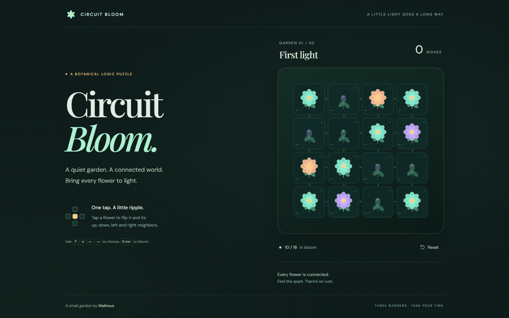

# Circuit Bloom

A little light goes a long way. Bring a luminous circuit garden to life in three short puzzles: tap a flower to flip it and its up, down, left and right neighbors. Bloom all sixteen to continue.

Built for Matheus's game development portfolio with **TypeScript, Vite and PixiJS 8.22.0**. Procedural flowers, circuit traces, spring transitions and a quiet botanical interface keep a small rule expressive. No account, timer, audio or backend.



[Watch the gameplay capture](output/playwright/gameplay.webm) · [Mobile screenshot](output/playwright/mobile.png) · [Completed garden](output/playwright/completion.png)

**Publication status:** the owner approved MIT licensing, source publication and GitHub Pages deployment on October 14, 2026. The public [GitHub repository](https://github.com/matsaraiva/circuit-bloom-pixijs) has been created; publication and demo verification are in progress.

## Play locally

Use Node.js **22.12 or newer**; Node.js 24.14.0 and npm 11.11.1 were used for verification. Dependency versions are pinned in `package-lock.json`.

```sh
npm ci
npm run dev
```

Open the local URL printed by Vite, including `/circuit-bloom-pixijs/`. To verify and preview the production version:

```sh
npm test
npm run typecheck
npm run build
npm run preview
```

The verified preview address is `http://127.0.0.1:4173/circuit-bloom-pixijs/`. Vite's preview server is for local inspection; publish the generated `dist/` files to a static host.

## Controls

| Action | Control |
| --- | --- |
| Flip a flower and its orthogonal neighbors | Click or tap any part of its cell |
| Select a flower using the keyboard | Tab to the board, then use the arrow keys |
| Flip the selected flower | Enter or Space |
| Jump to the first/last flower in a row | Home / End |
| Leave the board | Tab |
| Restore the current garden and clear moves | Reset |
| Advance after a win / replay after garden three | Next garden / Bloom again |

The gold outline marks the selected cell; mint outlines show its affected neighbors. Touch needs no hover. Open petals and closed buds communicate state through shape as well as color. Reduced-motion preferences disable the spring and celebration effects.

## A deliberately small architecture

```text
src/rules.ts   — immutable board operations, neighbor bounds, solved condition
src/levels.ts  — three fixed, reproducible gardens
src/game.ts    — moves, single win transition, reset, progression and replay
src/board.ts   — Pixi scene graph, pointer input, resize and animation
src/main.ts    — DOM interface, keyboard input and state integration
src/style.css  — responsive botanical presentation
tests/         — actual rule and state module tests
scripts/       — browser checks and gameplay capture through Playwright CLI
```

**State changes immediately; animation follows it.** Rapid input changes the target state without waiting for a transition. The renderer converges to that target, so animation cannot lose moves or decide whether a garden is solved. A win locks board input until the player chooses an action.

**The board belongs in Pixi; text belongs in the DOM.** Each flower uses prebuilt Graphics inside Containers, with full-cell hit areas and `pointertap`. The app initializes asynchronously, keeps one scene across resets, scales a fixed 560×560 coordinate space on resize, and caps render resolution at DPR 2. Ticker time drives short transitions; no geometry is rebuilt per frame. Visibility changes stop/resume the ticker. DOM buttons and status text remain keyboard accessible. See [PixiJS Application](https://pixijs.com/8.x/guides/components/application) and [Graphics](https://pixijs.com/8.x/guides/components/scene-objects/graphics).

The gardens are constructed by toggling an all-lit board with `[5,10]`, `[0,6,15]`, and `[1,7,8,14]` (zero-based row-major indices). Applying each sequence again solves it. Exhaustive tests of the actual modules confirm minimum move counts of **2, 3 and 4**; other valid solutions are accepted. The last garden starts entirely closed.

## Verification

Verified on **October 14, 2026**, using automated Chromium on Windows and a 360×800 touch context. `npm ci`, all 11 unit tests, TypeScript checking and the production build passed. Browser checks played all three gardens with mouse and touch, solved with keyboard, exercised reset/replay, resizing and reduced motion, and confirmed 20 rapid taps returned to identical canvas pixels. Ten resets retained one canvas and one state update per input. No page errors, console warnings or failed requests were recorded in the final browser run.

Screenshots above are from the production build served at the GitHub Pages subpath. Details and repeatable browser commands are in [QA.md](QA.md); raw results are in [verification.json](output/playwright/verification.json).

## Static hosting

`vite.config.ts` sets `base: '/circuit-bloom-pixijs/'` for a project repository on GitHub Pages. The [Pages workflow](.github/workflows/pages.yml) installs from the lockfile, runs tests, builds, and uploads `dist/`. It has a manual `workflow_dispatch` trigger. Use **GitHub Actions** as the repository's Pages source, then run the workflow to publish. See [Vite's static deployment documentation](https://vite.dev/guide/static-deploy.html#github-pages).

All fonts and artwork are served locally. Gameplay makes no third-party network requests and uses no stored progress or personal data.

## Scope and limitations

- Three fixed gardens; no generated levels, daily challenges, persistence or sound.
- WebGL is required. A readable error appears if renderer initialization fails.
- Touch testing is emulated Chromium, not a physical phone or proof of Safari/iPhone compatibility.
- Keyboard navigation and live announcements are included, but this canvas board has not been audited for full screen-reader accessibility.
- The visibility handler was tested with controlled visibility events because this automated browser reports background/minimized tabs as visible. No frame-rate benchmark or cross-browser certification is claimed.

## Credits, authorship and license

Original flower/circuit artwork and favicon are procedural geometry; no stock game assets or generated bitmap assets are used. DM Sans and Playfair Display are bundled through Fontsource under the SIL Open Font License 1.1. Full notices ship in `public/licenses/`; see [THIRD_PARTY.md](THIRD_PARTY.md).

This project was built with Codex assistance: a coordinator integrated the game, reviewed the visual result and ran final checks; two GPT-6 Luna workers implemented bounded rules/tests and rendering modules. Matheus supplied the portfolio direction and approved implementation scope. Matheus's own manual review remains pending.

The original code is licensed under [MIT](LICENSE), approved by the owner on October 14, 2026. Third-party components retain their own licenses.
